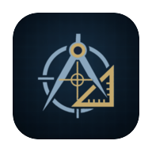

<p align="center">
  
</p>

<h1 align="center">PrecisionCAD Studio</h1>

<p align="center">
  Precision 2D engineering drafting, geometric construction, and technical annotation for Android.
</p>

<p align="center">
  <a href="https://github.com/AnimeXplayXD/PrecisionCAD-Studio/actions/workflows/build-signed-apk.yml">
    
  </a>
  <a href="https://github.com/AnimeXplayXD/PrecisionCAD-Studio/actions/workflows/lint.yml">
    
  </a>
  <a href="https://github.com/AnimeXplayXD/PrecisionCAD-Studio/releases/latest">
    
  </a>
  
  
  
</p>

<p align="center">
  <a href="https://github.com/AnimeXplayXD/PrecisionCAD-Studio/releases/latest">Latest Release</a>
  ·
  <a href="#feature-overview">Features</a>
  ·
  <a href="#download-and-installation">Installation</a>
  ·
  <a href="#build-from-source">Build from Source</a>
  ·
  <a href="#technical-documentation-index">Documentation</a>
</p>

---

## Overview

**PrecisionCAD Studio** (`com.precisioncad.studio`) is an Android application built with Kotlin and Jetpack Compose for strictly 2D engineering CAD drafting and technical annotation. It is designed around an analytical double-precision 2D geometry kernel, deterministic coordinate and object-snap control, automated and manual dimensioning, native project persistence, and vector drawing interchange.

The application focuses exclusively on 2D planar construction, sheet layout, and engineering documentation. It is not a 3D solid-modelling or mesh-authoring system.

---

## Feature Overview

### 2D Geometry and Editing

- **Double-Precision 2D Kernel (`CadGeometryKernel` & `CadModificationEngine`):** Analytical 2D representation using IEEE-754 `Double` coordinates (`Point2D`) and locale-invariant numeric formatting (`CadNumberFormatter` with `Locale.ROOT`).
- **Supported 2D Entities (`CadEntities.kt`):**
  - Linear and curve primitives: `LineEntity`, `PolylineEntity` (including arc bulge segments), `CircleEntity`, `ArcEntity`, `EllipseEntity`, `SplineEntity`, `RayEntity`, `XLineEntity`, and `DonutEntity`.
  - Hatching, blocks, and annotations: `HatchEntity`, `BlockInsertEntity` (`BlockDefinition`), `TextEntity`, `LeaderEntity`, `CenterMarkEntity`, and `DimensionEntity`.
- **Construction, Modification, and Parametric Constraints:**
  - Trim, extend, offset, fillet, chamfer, mirror, rotate, scale, rectangular/polar array, and polygon/rectangle construction tools with live preview synthesis.
  - Document layers (`CadLayer`) with visibility, lock, colour, linetype, and lineweight attributes, plus 2D geometric constraint records (`GeometricConstraintRecord`).

### Precision Input and Cursor Control

- **Direct Coordinate and Polar Entry (`CadSnapAndCoordEngine`):**
  - Supports absolute Cartesian (`X,Y`), relative Cartesian (`@dX,dY`), absolute polar (`R<θ`), relative polar (`@R<θ`), and direct distance entry (`R`).
  - Dedicated **Direct Coordinate Window** with mutually exclusive Cartesian (`X`, `Y`, `θ` with an `ABS` / `REL (@)` reference card deck) and Polar/Expression modes, plus a two-stage **Move Cursor → Preview → Pick** workflow.
- **Independent Storage and Display Units:**
  - Supports `mm`, `cm`, `m`, `in`, and `ft` with explicit unit-change behaviour (**Convert Display Units** vs. **Reinterpret Coordinates**).
- **Zoom-Adaptive Grid Snap:**
  - Scales the effective grid-snap interval inversely with viewport zoom across a quantized `1–2–2.5–5 × 10^n` engineering ladder with hysteresis and screen-space jump guards while preserving the nominal user-configured `gridSnapSpacing`.
- **Object Snaps (OSNAP) and ORTHO:**
  - Configurable object snaps (`Endpoint`, `Midpoint`, `Center`, `Quadrant`, `Intersection`, `Perpendicular`, `Tangent`, `Nearest`, `Node`) and orthogonal axis locking (`ORTHO`).
- **Separated Visual Polar Tracking and PolarSnap:**
  - **Visual Polar Tracking (`0°–359°`):** Informational angular tracking corridor (`0.35°` acquire / `0.55°` release hysteresis) that displays radial distance and bearing without constraining or projecting cursor coordinates.
  - **PolarSnap:** Independently toggled angular projection onto configured preset (`15°`, `30°`, `45°`, `60°`, `90°`) and custom snap angles, rendering the blue dashed PolarSnap guide ray only when `PolarSnap` is enabled and active.
- **Virtual Touchpad and Joystick Cursor Controller:**
  - Dual-mode on-screen precision cursor controller (1:1 relative touchpad and velocity joystick) with numeric step increments (`10`, `5`, `1`, `0.5`, `0.1`, `0.01`) and step-phase alignment during touchpad gestures.

### Dimensioning and Annotation

- **Shape-Aware Quick Dimension (`QDIM`):**
  - Classifies target geometry (`STANDALONE_CIRCLE`, `CONCENTRIC_CIRCLES`, `HOLE_PATTERN_WITHOUT_PLATE`, `STANDALONE_ARC`, `PLATE_WITH_HOLES`, `TRIANGLE_POLYGON`, `RECTANGLE_BOX`, `OPEN_POLYLINE_CONTOUR`, `MIXED_COMPOSITE`) to generate linear, radial (`R`), diameter (`⌀`), angular (`°`), and chamfer (`C`) dimensions appropriate to the shape family.
  - Configurable operating scope, arrangement preference (`AUTO_CHAIN`, `BASELINE_STACK`, `ORDINATE`), and density policy (`ESSENTIAL`, `BALANCED`, `DETAILED`).
- **Collision-Aware Placement (`DimensionAlignmentEngine` & `AdaptiveAnnotationRenderer`):**
  - Uses 1D interval-graph lane allocation to tier parallel linear dimensions and 2D bounding-box / segment-intersection checks to reduce collisions between dimension text, arrowheads, witness lines, and model contours.
- **Selective Dimension Removal:**
  - Category-first inspection and removal dialog supporting bulk or individual dimension deletion without resetting list scroll position.

### Paper Space and Drawing Layout

- **Model Space and Paper Space Workspaces:**
  - Switch between 1:1 `MODEL_SPACE` drafting and `PAPER_SPACE` sheet composition.
- **Sheet Presets and Opaque Title Block Rendering:**
  - Configurable engineering sheet sizes (`A4`, `A3`, `A2`, `A1`, `ANSI A–D`), orientation, scale text, and title-block fields.
  - Two-pass Paper Space rendering draws the sheet base before the grid and renders an opaque title-block pass after the grid with zoom-independent screen-space typography so grid lines never bleed through the title block.

### Saving and Interchange

PrecisionCAD Studio separates native project persistence from external CAD and vector export formats:

| Format | Role | Description |
| :--- | :--- | :--- |
| **`.pcad`** | Native project persistence | Versioned JSON project container (`schemaVersion = 2`) that preserves entities, layers, blocks, constraints, units, sheet setup, grid/snap settings, controller preferences, and QDIM state. Supports automatic app-private quick-save (`pcad_autosave/quick_save_working.pcad`) and explicit save/load under `Documents/PrecisionCAD/`. |
| **`.dxf`** | CAD interchange | ASCII DXF import and export targeting `AC1015` (AutoCAD 2000) section and entity records (`HEADER`, `TABLES`, `BLOCKS`, `ENTITIES`). |
| **`.pdf`** | Plot / technical document export | Vector sheet and model plotting generated via Android's `PdfDocument` API with synchronized project/title-block naming. |
| **`.svg`** | Vector interchange | 2D vector path export and basic SVG path/primitive import (`CadDxfInterchange.kt`). |

> **Note:** `.pcad` is PrecisionCAD Studio's native project format, not DWG. Native DWG or DWF reading/writing is not implemented.

### Release Catalogue and In-App Update Handoff

- **GitHub Release Catalogue (`CadAppUpdater.kt`):**
  - Queries the repository's GitHub Releases feed (`AnimeXplayXD/PrecisionCAD-Studio`), surfaces update availability on the Home screen, and presents a chronological release changelog timeline.
- **Pre-Install Verification and System Handoff:**
  - Downloads the release APK over HTTPS into private app staging storage, verifies the SHA-256 digest, package name (`com.precisioncad.studio`), monotonic `versionCode`, and signing certificate, and hands the verified APK to Android's `PackageInstaller` session flow.
  - Android system permissions and standard user confirmation prompts govern the final installation step.

---

## Download and Installation

Published production Release builds are distributed through GitHub Releases:

- **Latest Release:** [https://github.com/AnimeXplayXD/PrecisionCAD-Studio/releases/latest](https://github.com/AnimeXplayXD/PrecisionCAD-Studio/releases/latest)
- **All Releases:** [https://github.com/AnimeXplayXD/PrecisionCAD-Studio/releases](https://github.com/AnimeXplayXD/PrecisionCAD-Studio/releases)

### Installing on Android

1. Open the [Latest Release](https://github.com/AnimeXplayXD/PrecisionCAD-Studio/releases/latest) page on your Android device (requiring **Android 7.0 / API 24** or newer) and download the signed Release `.apk` asset.
2. Open the downloaded APK or use the in-app **Release Catalogue** updater from the Home screen.
3. If prompted by Android, grant permission to install applications from your browser or from PrecisionCAD Studio, then confirm the system `PackageInstaller` prompt.

> **Repository visibility note:** If the repository is private at the time you access the links above, GitHub requires an authenticated account with repository read access to view releases and workflow status badges.

---

## Build from Source

### Prerequisites

- **JDK 21** (Temurin 21 is used in CI)
- **Android SDK** with:
  - `platform-tools`
  - `platforms;android-37.2` (Android API 37, minor API level 2)
  - `build-tools;37.0.0`
- **Git**

The repository includes the pinned Gradle Wrapper (`9.8.2`), so a separate local Gradle installation is not required.

### Commands

```bash
git clone https://github.com/AnimeXplayXD/PrecisionCAD-Studio.git
cd PrecisionCAD-Studio

# Verify the checked-in Gradle Wrapper and JVM toolchain
./gradlew --version

# Run Android Release lint analysis
./gradlew :app:lintRelease

# Run local JVM unit and Robolectric tests
./gradlew :app:testDebugUnitTest

# Assemble a Debug APK (signed with the local debug keystore)
./gradlew :app:assembleDebug

# Assemble a production Release APK (requires configured production signing credentials)
./gradlew :app:assembleRelease
```

On Windows, replace `./gradlew` with `gradlew.bat`.

> **Production Release signing notice:** Building a production Release APK (`:app:assembleRelease`) in CI or for distribution requires the maintainer's production signing keystore and credentials. A Debug build (`:app:assembleDebug`) uses the debug signing configuration and does not validate production release signing. See [`docs/BUILD_AND_RELEASE.md`](docs/BUILD_AND_RELEASE.md) for details on the fail-closed release signing pipeline.

---

## Technology Stack

All version values below are taken directly from [`gradle/libs.versions.toml`](gradle/libs.versions.toml), [`gradle/wrapper/gradle-wrapper.properties`](gradle/wrapper/gradle-wrapper.properties), [`app/build.gradle.kts`](app/build.gradle.kts), and [`version.properties`](version.properties):

| Component | Value |
| :--- | :--- |
| **Platform** | Android |
| **Application ID** | `com.precisioncad.studio` |
| **Base Version (`version.properties`)** | `1.18.3` (base `VERSION_CODE = 20`) |
| **Language** | Kotlin `2.4.21` |
| **UI Toolkit** | Jetpack Compose (Compose BOM `2026.09.00`, Material 3) |
| **Build System** | Gradle Wrapper `9.8.2` |
| **Android Gradle Plugin (AGP)** | `9.1.1` |
| **Kotlin Symbol Processing (KSP)** | `2.3.13` |
| **Local Database & Serialization** | Room `2.8.5`, Moshi `1.15.2` |
| **Concurrency** | Kotlin Coroutines `1.11.0` |
| **Minimum Android SDK (`minSdk`)** | API `24` (Android 7.0) |
| **Target Android SDK (`targetSdk`)** | API `37` |
| **Compile Android SDK (`compileSdk`)** | API `37`, minor API level `2` (`android-37.2`) |
| **Java Bytecode Target** | Java `11` (`JavaVersion.VERSION_11`) |
| **CI Runner JDK** | JDK `21` (Temurin on `ubuntu-26.04`) |
| **Unit & UI Verification** | JUnit `4.13.2`, Robolectric `4.17`, Compose UI Test |

---

## Architecture at a Glance

PrecisionCAD Studio is organized into five deterministic packages under `app/src/main/java/com/example/`:

- **`cad/model/` — Domain Entities & Units:** Immutable 2D entity definitions (`CadEntities.kt`), unit systems, sheet configurations, command specifications, and locale-invariant number formatting (`CadUnitsAndSheet.kt`).
- **`cad/kernel/` — Analytical 2D Geometry & Snapping:** Exact intersection solvers, entity modification algorithms (`CadGeometryKernel.kt`, `CadModificationEngine.kt`), coordinate expression parsing, OSNAP evaluation, zoom-adaptive Grid Snap, and separated Visual Polar Tracking / PolarSnap (`CadSnapAndCoordEngine.kt`).
- **`cad/dimension/` — Quick Dimension & Alignment Engine:** Shape-aware geometry classification (`QuickDimensionEngine.kt`), 1D interval-graph lane allocation, 2D collision resolution (`DimensionAlignmentEngine.kt`), and annotation layout (`AdaptiveAnnotationRenderer.kt`).
- **`cad/io/`, `cad/data/`, & `cad/update/` — Persistence, Interchange & Updater:** Native `.pcad` serialization and atomic quick-save (`CadPcadPersistence.kt`), DXF/PDF/SVG interchange (`CadDxfInterchange.kt`), local Room project catalogue (`CadRoomDatabase.kt`), and GitHub Releases verification/install handoff (`CadAppUpdater.kt`).
- **`ui/` — Jetpack Compose Workspace & Shared Components:** Single-source-of-truth workspace state holder (`CadWorkspaceViewModel.kt`), multi-pass technical viewport (`CadViewportCanvas.kt`), virtual cursor controller (`VirtualCursorController.kt`), reusable card-deck state machine (`CadBinaryToggleCard.kt`), and engineering configuration dialogs (`CadDialogsAndPanels.kt`, `CadReleaseCatalogueDialog.kt`).

For a complete breakdown of rendering passes and state ownership, see [`docs/ARCHITECTURE.md`](docs/ARCHITECTURE.md).

---

## Technical Documentation Index

| Document | What the reader will find |
| :--- | :--- |
| [`docs/ARCHITECTURE.md`](docs/ARCHITECTURE.md) | Application layers, renderer passes, state ownership, and UI architecture. |
| [`docs/GEOMETRY_AND_COORDINATES.md`](docs/GEOMETRY_AND_COORDINATES.md) | Geometry kernel, coordinate grammar, zoom-adaptive snapping, and polar behaviour. |
| [`docs/COMMANDS_AND_PREVIEWS.md`](docs/COMMANDS_AND_PREVIEWS.md) | CAD command state machine, interactive previews, and temporary guides. |
| [`docs/DIMENSION_SYSTEM.md`](docs/DIMENSION_SYSTEM.md) | Shape-aware QDIM, dimension alignment, annotation placement, and selective removal. |
| [`docs/STORAGE_AND_FORMATS.md`](docs/STORAGE_AND_FORMATS.md) | Native `.pcad` persistence, autosave, explicit save, and DXF/PDF/SVG interchange formats. |
| [`docs/BUILD_AND_RELEASE.md`](docs/BUILD_AND_RELEASE.md) | SDK/toolchain setup, CI workflows, fail-closed production signing, and GitHub Release automation. |
| [`docs/LICENSING_INVENTORY.md`](docs/LICENSING_INVENTORY.md) | Informational source and dependency licence inventory and ScanCode workflow. |

---

## Current Limitations

- **Strictly 2D Drafting Scope:** PrecisionCAD Studio supports 2D planar geometry and technical annotation only; 3D solid modelling, 3D meshes, and Z-axis extrusions are outside the application's scope.
- **File Format Boundaries:** `.pcad` is the native project persistence format; `.dxf` (`AC1015`), `.pdf`, and `.svg` serve as interchange and plot formats. Native DWG and DWF formats are not supported.
- **Production Release Signing:** Creating an official signed Release APK via CI requires the repository's configured production signing secrets and certificate verification pass (`scripts/verify_apksigner_certificate.py`).
- **System Installation Confirmation:** In-app update downloads are verified prior to handoff, but final package installation is always subject to Android `PackageInstaller` policies and user confirmation on the target device.

---

## Licence and Third-Party Component Notice

- **Project Licence Status:** A project-level root `LICENSE` file has not yet been declared in this repository. Without an explicit licence grant from the copyright holder, standard copyright rules apply and no open-source redistribution or modification licence should be assumed.
- **Informational Third-Party & Source Inventory:** The repository maintains an automated, non-blocking licensing inventory workflow documented in [`docs/LICENSING_INVENTORY.md`](docs/LICENSING_INVENTORY.md) (with generated reports written to `reports/licensing/`). That inventory records third-party dependency metadata and source-file scan results strictly for informational visibility and does not itself grant a licence or constitute a legal determination.

---

## Project Status and Issue Reporting

PrecisionCAD Studio is an actively maintained Android 2D CAD application. Defect reports, reproducibility notes, and technical discussions can be submitted through the repository's [GitHub Issues](https://github.com/AnimeXplayXD/PrecisionCAD-Studio/issues) page when accessible to your account.
